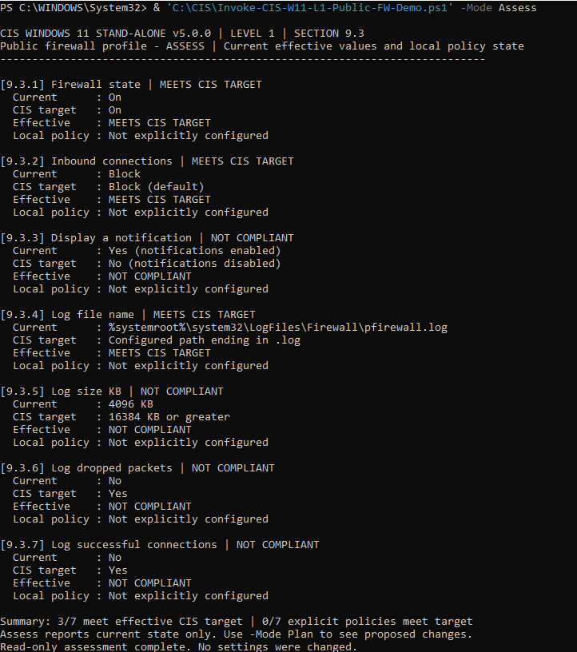
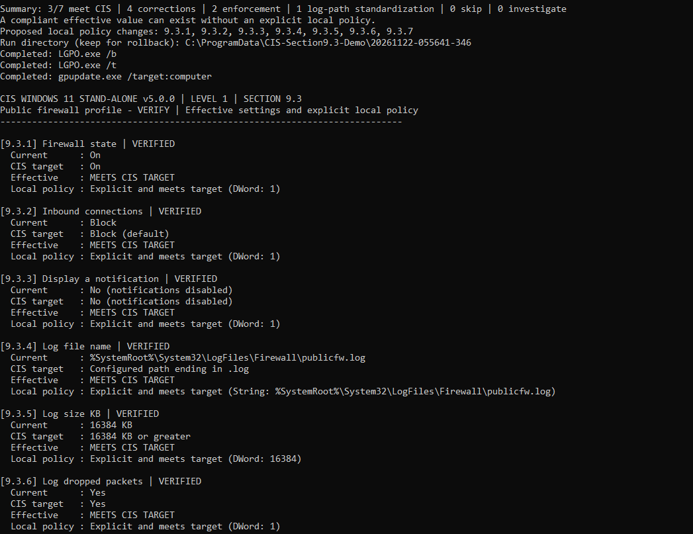
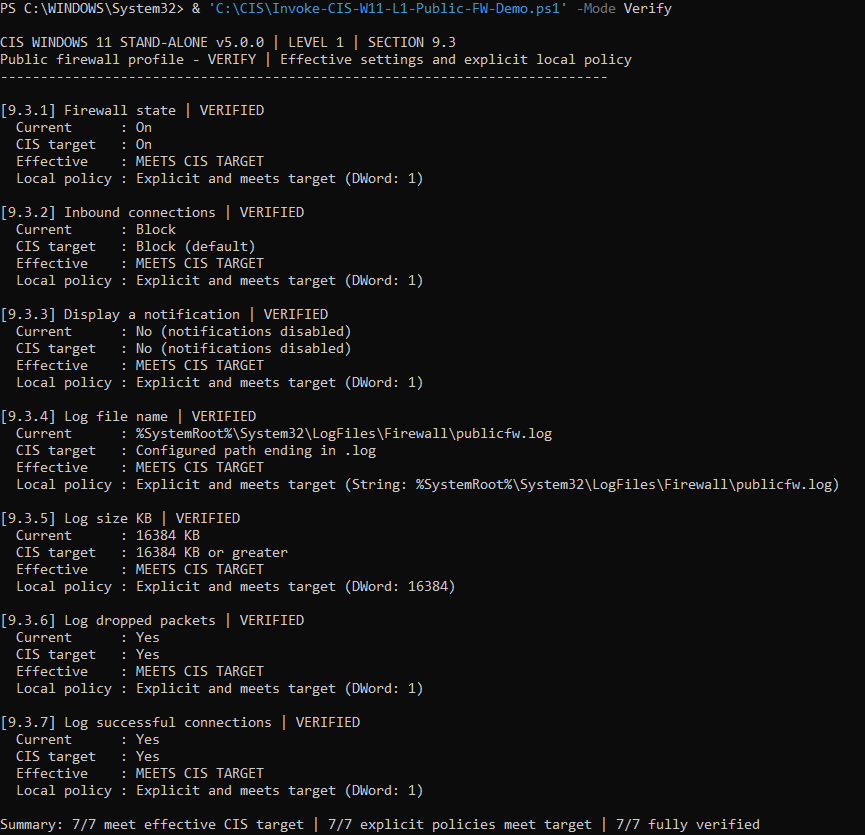
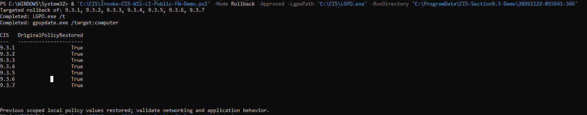

# Lab validation - CIS Windows 11 Level 1, Section 9.3

This is the observed end-to-end test of the `Invoke-CIS-W11-L1-Public-FW-Demo.ps1` sample, covering the seven Public Firewall Profile recommendations from the CIS Windows 11 Stand-alone Benchmark v5.0.0. The screenshots are console captures from the Windows VM; they are not generated representations of a test run.

## Environment and scope

- Standalone Windows 11 VM in Oracle VirtualBox
- Windows PowerShell 5.1 (64-bit)
- Microsoft LGPO.exe version 3.0.2004.13001
- Snapshot available before applying the test policy
- Test date: November 22, 2026
- Scope: the seven local policy entries in Section 9.3 (Public Firewall Profile)

## Observed results

| Stage | Result |
| --- | --- |
| Assess | 3/7 effective values met the CIS targets; 0/7 had matching explicit local policy entries |
| Plan | Four value corrections, two compliant-default enforcement actions, one optional log-path standardization |
| TestLGPO | Generated full section and delta policy files compiled and parsed with LGPO.exe |
| Apply | LGPO local policy backup, policy-text import, and computer policy refresh completed successfully |
| Verify | 7/7 effective values and 7/7 explicit local policy entries met the selected targets |
| Rollback | `OriginalPolicyRestored = True` for all seven original policy entries |
| Reassess | Returned to the original 3/7 effective and 0/7 explicit-policy state |

## Console evidence

### 1. Initial assessment

### 2. Apply using LGPO

### 3. Independent verification

### 4. Targeted rollback

## Interpretation and limitations

The test establishes that the example successfully assessed, planned, applied, verified, and reverted the seven selected local Windows Firewall policy entries in this VM. It does not certify overall CIS benchmark compliance, demonstrate production application compatibility, or validate behavior on domain-joined, Entra-managed, MDM-managed, or different hardware configurations.

A separate Public-profile log filename (`publicfw.log`) is used as an optional project convention, not as a mandatory CIS filename. Local Group Policy backup and targeted rollback are not a full system image or substitute for a VM snapshot.